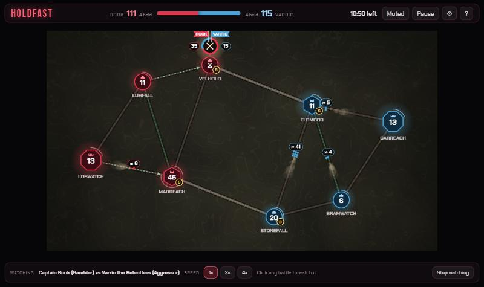
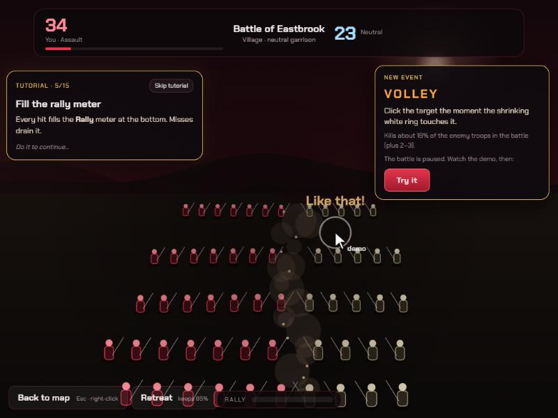

# Holdfast

A small real-time strategy game about **where to spend your attention**. Two realms fight over 6–16 strongholds joined by roads. You send troops down the roads as columns. When armies meet, a battle starts. Left alone, numbers decide it. Step inside and mouse-driven quick-time events swing the fight. But the battle view hides the map, and you can only be in one battle at a time. The enemy commander has the same limit, and its flag shows where it is.

**Status: playable prototype** (single player vs AI, desktop browser, mouse). It has a ten-mission campaign, a tutorial, Training with a high-score Gauntlet, eight quick-time events, five commanders, four AI rivals, fog of war and an AI-vs-AI watch mode. There's no online play, mobile support or license yet (see [Known limitations](#known-limitations)).

**Play:** https://holdfast-umber.vercel.app (desktop browser, mouse). Every push to `main` redeploys it.




## How to play

1. Click **Tutorial** on the start screen. It's a 15-step guided level that pauses while you read and demonstrates each quick-time event the first time it appears.
2. **Drag** from one of your strongholds to another to send troops. The bottom bar sets how many (25–100%) and the stance (Assault, Hold, Skirmish).
3. Click a battle's **crossed swords** to fight in it yourself. The quick-time events are:
   - **Volley:** click the target as the ring closes.
   - **Parry:** click the incoming spear.
   - **Slash:** drag along the line.
   - **Banner:** hold the mouse on the banner.
   - **Pursuit:** catch the fleeing soldiers.
   - **Duel:** when both commanders are in the same battle, click first on the signal.
   - **Battering Ram** (storming a fort or capital): click the gate on three beats. A breach lowers the walls for 15 s.
   - **Boiling Oil** (holding a fort or capital): hold on the wall and sweep over every ladder.
4. Hits fill your **rally meter**. A full meter unlocks **CHARGE!** (a quarter of the enemy falls). The meter belongs to your commander, so you can save it for the fight that matters.
5. **Win** by taking the enemy capital. A 12-minute clock breaks deadlocks.

Other controls:
- **Right-drag:** set a rally route that forwards new troops automatically.
- **Click a column:** turn it back.
- **Orders:** March, Inspire and Spy.
- **Training:** practise any event on its own, or run the **Gauntlet**: every event in random order, faster with each hit, until three misses. Best score and a per-event record (hit rate, best streak) are kept in the browser.
- **Resign** appears in the top bar only while you are behind (fewer troops, or fewer strongholds and not more troops). Click it twice to concede.
- **Esc** leaves a battle, **P** pauses, **M** mutes.

## Campaign: The Border War

Ten missions against the four rivals, in four acts and a finale. Each has a hand-made map, its own objective (take the capital, capture named strongholds against the clock, hold a fort through scripted waves, or survive), scripted moments, and two bonus stars on top of the win (for example "breach the gate twice", "win without using Spy", "never lose the West Bridgehead"). Winning a mission opens the next; stars and progress are saved in the browser. Any event you have never tried is demonstrated the first time it comes up.

| # | Mission | Rival | Objective |
| --- | --- | --- | --- |
| 1 | The Border Villages | Morwen (easy, passive) | Capture three villages within 5:00 |
| 2 | Greywall | Morwen (easy) | Take a walled fort |
| 3 | Hold Greywall | Morwen (normal) | Hold the fort through four waves until 3:00 |
| 4 | Marsh of Whispers | Silas (easy, fog) | Take the capital across marsh roads |
| 5 | Two Fronts | Silas (easy) | Take twin forts within 8:00 |
| 6 | The Gambler's Bridge | Rook (normal) | Take the capital across a single bridge |
| 7 | Outnumbered | Rook (hard) | Keep your capital until 3:00 against reinforcements |
| 8 | Raider's Roads | Varric (normal) | Take the capital on all-paved roads |
| 9 | The Iron Ring | Varric (normal) | Break through two forts to the capital |
| 10 | Holdfast | Varric (hard, fog) | A full 12-stronghold war |

## Run locally

```bash
npm install
npm run dev     # http://127.0.0.1:5360
npm test        # 50 tests: maps, battle maths, commanders, sieges, campaign, AI-vs-AI wars
npm run build   # static site in dist/ (deployed on Vercel from `main`)
```

It's a static site built with Vite, TypeScript and Canvas 2D. It has no backend or accounts, and makes no network calls besides loading Google Fonts. Preferences are kept in the browser's localStorage.

## Verification

- **Automated (`npm test`, 50 passing):**
  - Map generation for every size: connected, point-symmetric and deterministic.
  - Garrison growth, captures, wall bonuses, road ambushes.
  - Battle maths, stances, rout, retreat, rally meter and Charge, including the banked meter carrying between battles.
  - Every commander's effect, special strongholds, road speeds, rally routes, order cooldowns.
  - Fog-of-war visibility and memory.
  - Siege events: who gets the Ram or the Oil, a breach lowering walls for 15 s, Oil kills.
  - Every campaign mission builds a connected map with both capitals, and finishes.
  - AI-vs-AI wars finishing on every size and difficulty, with and without fog, and every rival personality against every other.
- **Balance runs (AI vs AI):**
  - A commander who plays quick-time events beat one who never does in 12 of 12 games.
  - Each rival personality won 37–63% of 48 games.
  - A 20-map sweep had no stalemates.
  - **Campaign difficulty:** each mission played 6 times by an AI standing in for the player at Normal quick-time accuracy (70%) and 6 times at Hard (82%). Normal stand-in wins ranged from 2/6 (The Gambler's Bridge) to 6/6 (early missions); the Hard stand-in won 5–6 of 6 everywhere. A human plays differently from this stand-in, so these numbers only show that each mission is winnable and roughly where it sits on the curve.
- **Browser checks (scripted, in a real browser):**
  - Each quick-time event completed with real mouse input. Banner was the exception and used dispatched events, because the automation can't hold a button down.
  - The full tutorial played step by step to "Tutorial complete", including every first-time demo and the final duel.
  - Campaign: mission select and briefing; Mission 1 played to "Mission complete" with stars saved and Mission 2 unlocked; Mission 2's Battering Ram lesson and a real breach; Mission 3's waves and countdown.
  - Gauntlet: a full run through all eight events to a saved best score; Battering Ram and Boiling Oil drawn and completed in Training demos.
  - Watch mode, settings, fog and the end screen.
  - No console errors.
- **Human testing:** Zach played several wars (for example 8 strongholds against the Turtle rival) and his feedback drove the tuning: 2.5× quick-time power, 20% longer fights, more Pursuits, the eased Archer ring and the banked Charge.
- **Never tested:**
  - other people (strangers, new players)
  - mobile or touch
  - browsers other than Chromium
  - screen readers
  - audio on a wide range of devices
  - the clarity of the tutorial for someone who has never played
  - the campaign, Gauntlet and siege events by a human (all new and only machine-checked so far)

## Known limitations

- **Desktop and mouse only.** The layout gets cramped below about 1000 px wide, and touch input isn't supported.
- **The AI is decent, not clever.** It values ground and attacks where your commander isn't, but a patient player can out-think it.
- **No online play yet.** The simulation is deterministic and every action is a command, so online 1v1 by lockstep is planned, but it isn't built.
- **Campaign progress lives in one browser.** Clearing site data resets it, and it doesn't sync between devices.
- **Balance numbers come from AI-vs-AI runs and one player.** They haven't been tested with a wider group.
- `window.__holdfast` exposes a debug hook used by the automated browser checks.

## Design history

- **v0.1–v0.2: a dots-and-territory game.** It had squads, fronts, supply lines, fog and healing mini-games. Zach played it and found it not fun ("completely revamp"), so it was thrown away. It's still in git history (`1c8ecfc`, `865fe5c`).
- **v0.3: "node battles."** Zach chose this from a list of redesign ideas: a strongholds-and-roads war where quick-time events decide fights. He liked it much more, and asked for stronger quick-time effects and a plan for depth (`ROADMAP.md`).
- **Phases 1–4** (built 2026-10-19), layered on in order:
  - battle decisions: rally and Charge, retreat, stances, rout, Pursuit, commander duels
  - feel: synthesized sound, visible casualties, map effects
  - map depth: special strongholds, road types, rally routes, orders, fog of war
  - commanders and rival personalities
- **Then** came playtest tweaks, AI-vs-AI watch mode, bigger maps, the guided tutorial and the banked rally meter.
- **Phase 5:** the siege events (so forts play differently), the Gauntlet and event records, and the ten-mission campaign. Zach asked for the campaign and a high-score training mode and left the design to Claude.

## Story

Zach wanted a real-time strategy game where fights are won by your own hands, not only your numbers. The bet was that a quick-time layer can add skill to an RTS without turning it into a reflex game, because every second spent inside one battle is a second you aren't watching the rest of the map. Holdfast is an original game in the minimalist send-troops-between-bases genre. Its names, maps, art and sounds are its own, and everything is drawn in code and synthesized at runtime.

## AI assistance and Zach's role

This was built in a highly AI-assisted way.

**Claude** (Anthropic's Claude Code) wrote essentially all the code, tests, balance tooling and documentation, and did the scripted browser verification.

**Zach Shirley** directed it:
- He set the concept and constraints: mouse-only events centred on screen, all melee, 6–10 strongholds to start, and no reuse of the old healing mini-game.
- He rejected the first version and chose the node-battles redesign.
- He playtested and called the tuning: 2.5× quick-time power, longer fights, more Pursuits, the eased Archer ring, banked Charge, and fog hiding more.
- He asked for the AI-vs-AI watch mode and the tutorial, and decided what ships.

## Attribution and rights

There are no third-party assets. Fonts load from Google Fonts (Bebas Neue and Chakra Petch, both under the SIL Open Font License). All graphics are drawn with Canvas 2D, and all sounds are synthesized with Web Audio.

**All rights reserved; source is public to read.** No license has been chosen yet.

---

## Mechanics reference

| Stronghold | Growth | Cap | Walls |
| --- | --- | --- | --- |
| Capital | 1.0/s | 70 | ×1.5 |
| Fort | 0.35/s | 60 | ×1.4 |
| Village | 0.75/s | 50 | none |

- **Battles:** each side loses `(0.5 + 0.0375 × enemy troops) × enemy momentum × enemy walls` troops per second, adjusted by stance. A side below 25% of its peak strength **routs** and takes +25% losses. Reinforcements join a battle when they arrive, and two enemy columns meeting on a road fight there.
- **Quick-time effects** are multiplied by 2.5. Momentum is capped at 4× and decays over time. A Shrine nearby adds +25%.
- **Rally meter:** each hit adds 25% and each miss drains 15%. Charge kills 25% of the enemy plus 3. The meter is kept per commander across battles.
- **Retreat** keeps 85% and sends the column to the nearest friendly stronghold.
- **Stances:**
  - Assault: +20% damage dealt.
  - Hold: −20% damage taken.
  - Skirmish: +25% march speed.
  - Each stance also makes one event type more common.
- **Specials** (about two thirds of the mirrored node pairs):
  - Barracks: +50% growth.
  - Watchtower: long vision, fog only.
  - Forge: +0.3 starting momentum nearby.
  - Shrine: +25% quick-time power nearby.
- **Roads:** marsh ×0.65 speed, paved ×1.3.
- **Orders:**
  - March: 2× speed for 15 s, 45 s cooldown.
  - Inspire: +0.6 momentum and +50% rally, 60 s cooldown.
  - Spy: full vision and enemy destinations for 20 s, 75 s cooldown.
- **Commanders:**
  - Archer: Volleys kill +60%, with an eased ring that pauses at the perfect moment.
  - Duelist: Slash also kills, and wins near-tied duels.
  - Iron Wall: missed Parries cost nothing, and walls get +0.2.
  - Raider: columns +25% speed, and road ambushes start with extra momentum.
  - Herald: the rally meter fills 40% faster.
- **Rivals:** Varric (Aggressor), Morwen (Turtle), Silas (Opportunist) and Rook (Gambler). Each has its own commander, tendencies and taunts. Difficulty sets their quick-time success rate (55/70/82%) and reaction speed.
- **Fog of war** (optional):
  - You see around your own strongholds, columns and battles.
  - Distant enemy counts are rounded to the nearest 5.
  - Unseen nodes show your last sighting.
  - The AI plays under the same rules.

## Code map

| File | Role |
| --- | --- |
| `src/map.ts` | Seeded, point-symmetric stronghold and road graph (6–16 nodes), specials, road types |
| `src/sim.ts` | Deterministic simulation: garrisons, columns, battles, quick-time effects, orders, fog, victory |
| `src/ai.ts` | AI strategy and commander, rival personalities |
| `src/battleview.ts` | Full-screen battle scene, the six quick-time events, Training demos |
| `src/render.ts` | Map renderer |
| `src/tutorial.ts` | The tutorial level and its coach |
| `src/campaign.ts` | Campaign missions, objectives, scripted moments and stars |
| `src/records.ts` | Saved records: event mastery, Gauntlet best, campaign stars |
| `src/sound.ts` | Synthesized sound effects and music |
| `src/main.ts` | Screens, input, HUD and the game loop |
